# Mein digitales Lookbook

Automatisch generiert vom `lookbook_sync` Workflow. Originale liegen in [schrank/](schrank/) und [look/](look/).

---

## Mein Schrank

### Oberteil

#### Weißes Leinenhemd

**Kategorie:** oberteil · **Farben:** weiß

[Original ansehen](schrank/IMG_5263.JPEG)

#### Grauer Strickpullover

<a href="https://github.com/Julian-Lukas/lookbook/blob/main/schrank/IMG_5264.JPEG">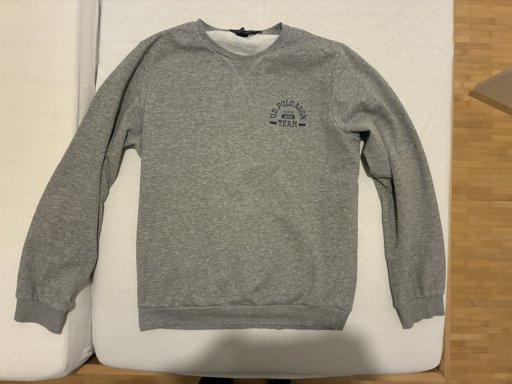</a>

**Kategorie:** oberteil · **Farben:** grau

[Original ansehen](schrank/IMG_5264.JPEG)

#### Schwarzes T-Shirt

**Kategorie:** oberteil · **Farben:** schwarz

[Original ansehen](schrank/IMG_5265.JPEG)

#### gestreifter Pullover

<a href="https://github.com/Julian-Lukas/lookbook/blob/main/schrank/IMG_5267.JPEG">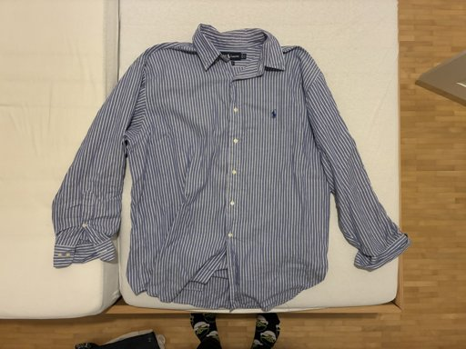</a>

**Kategorie:** oberteil · **Farben:** blau, weiß

[Original ansehen](schrank/IMG_5267.JPEG)

#### Weißes Leinenhemd

**Kategorie:** oberteil · **Farben:** weiß

[Original ansehen](schrank/IMG_5268.JPEG)

#### Grauer Strickpullover

**Kategorie:** oberteil · **Farben:** grau

[Original ansehen](schrank/IMG_5269.JPEG)

#### Weißes Leinenhemd

**Kategorie:** oberteil · **Farben:** weiß

[Original ansehen](schrank/IMG_5271.JPEG)

#### grauer Denim Overall

<a href="https://github.com/Julian-Lukas/lookbook/blob/main/schrank/IMG_5272.JPEG">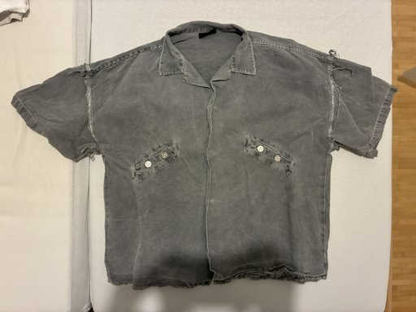</a>

**Kategorie:** oberteil · **Farben:** grau, dunkelblau

[Original ansehen](schrank/IMG_5272.JPEG)

#### gestreifter Rollkragenpullover

**Kategorie:** oberteil · **Farben:** schwarz, weiß

[Original ansehen](schrank/IMG_5273.JPEG)

#### Grauer Strickpullover

**Kategorie:** oberteil · **Farben:** grau

[Original ansehen](schrank/IMG_5274.JPEG)

#### kariertes Hemd

<a href="https://github.com/Julian-Lukas/lookbook/blob/main/schrank/IMG_5275.JPEG">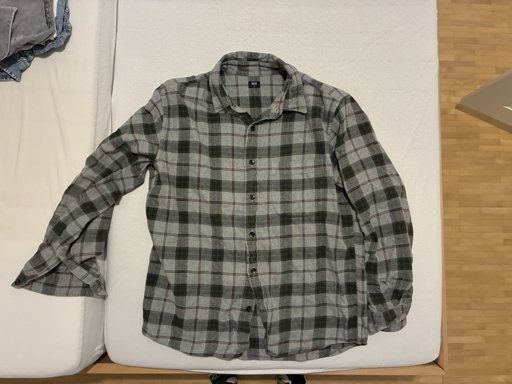</a>

**Kategorie:** oberteil · **Farben:** schwarz, weiß

[Original ansehen](schrank/IMG_5275.JPEG)

#### Schwarzes T-Shirt mit Logo

<a href="https://github.com/Julian-Lukas/lookbook/blob/main/schrank/IMG_5278.JPEG">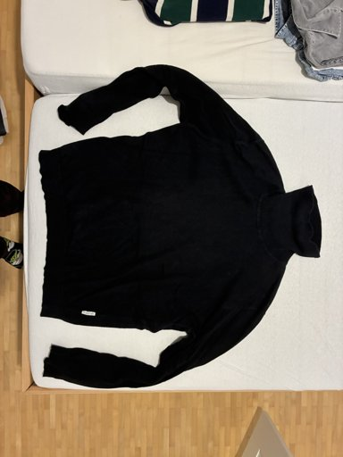</a>

**Kategorie:** oberteil · **Farben:** schwarz, weiß

[Original ansehen](schrank/IMG_5278.JPEG)

#### Schwarzes Rollkragen-Shirt

**Kategorie:** oberteil · **Farben:** schwarz

[Original ansehen](schrank/IMG_5279.JPEG)

#### Beige Leinenbluse

**Kategorie:** oberteil · **Farben:** beige, weiß

[Original ansehen](schrank/IMG_5282.JPEG)

#### weißes Leinenhemd

<a href="https://github.com/Julian-Lukas/lookbook/blob/main/schrank/IMG_5283.JPEG">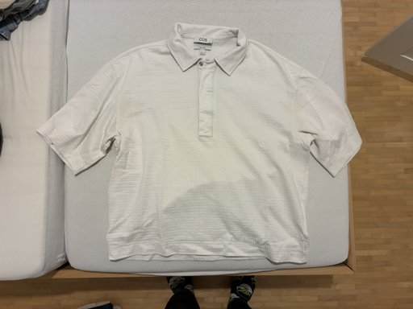</a>

**Kategorie:** oberteil · **Farben:** weiß

[Original ansehen](schrank/IMG_5283.JPEG)

#### weißes Leinenhemd

<a href="https://github.com/Julian-Lukas/lookbook/blob/main/schrank/IMG_5284.JPEG">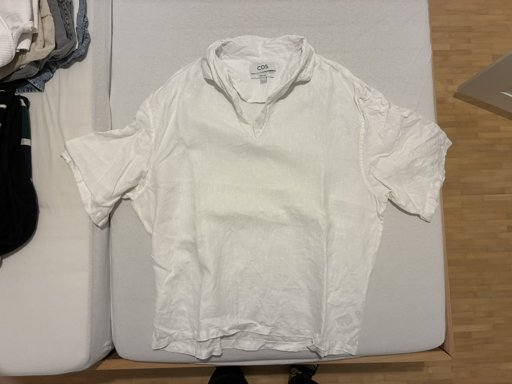</a>

**Kategorie:** oberteil · **Farben:** weiß

[Original ansehen](schrank/IMG_5284.JPEG)

#### lila Rollkragenpullover

**Kategorie:** oberteil · **Farben:** lila

[Original ansehen](schrank/IMG_5285.JPEG)

#### Schwarzes Rollkragen-Shirt

**Kategorie:** oberteil · **Farben:** schwarz

[Original ansehen](schrank/IMG_5286.JPEG)

#### Schwarzes T-Shirt

**Kategorie:** oberteil · **Farben:** schwarz

[Original ansehen](schrank/IMG_5287.JPEG)

#### Grünes Leinen-Oberteil

**Kategorie:** oberteil · **Farben:** grün

[Original ansehen](schrank/IMG_5290.JPEG)

#### schwarzes Rundhals-Shirt

**Kategorie:** oberteil · **Farben:** schwarz

[Original ansehen](schrank/IMG_5291.JPEG)

#### schwarzes Rundhals-Shirt

<a href="https://github.com/Julian-Lukas/lookbook/blob/main/schrank/IMG_5292.JPEG">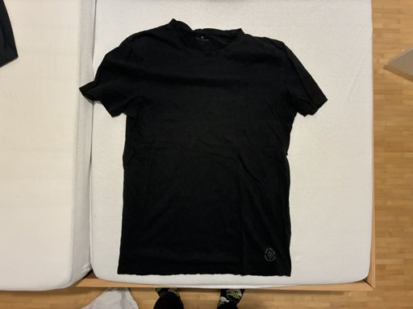</a>

**Kategorie:** oberteil · **Farben:** schwarz

[Original ansehen](schrank/IMG_5292.JPEG)

#### Schwarzes Rundhals-Shirt

**Kategorie:** oberteil · **Farben:** schwarz, weiß

[Original ansehen](schrank/IMG_5293.JPEG)

### Hose

#### graue Stoffhose

<a href="https://github.com/Julian-Lukas/lookbook/blob/main/schrank/IMG_5298.JPEG">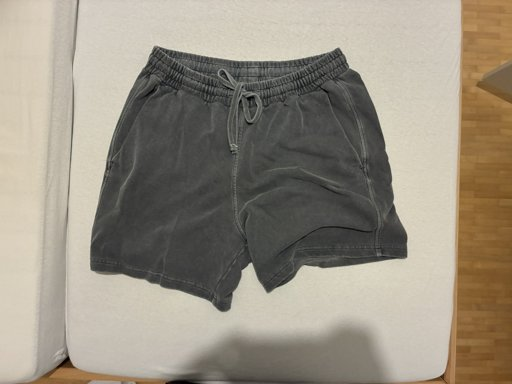</a>

**Kategorie:** hose · **Farben:** grau

[Original ansehen](schrank/IMG_5298.JPEG)

#### Beige Leinenhose

<a href="https://github.com/Julian-Lukas/lookbook/blob/main/schrank/IMG_5302.JPEG">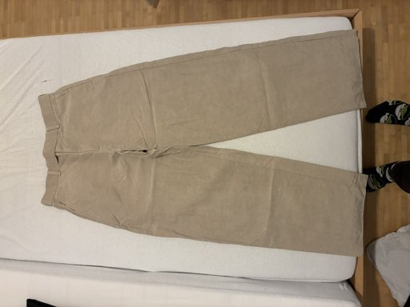</a>

**Kategorie:** hose · **Farben:** beige

[Original ansehen](schrank/IMG_5302.JPEG)

### Jacke

#### Schwarze Lederjacke

**Kategorie:** jacke · **Farben:** schwarz

[Original ansehen](schrank/IMG_5259.JPEG)

#### Schwarze Lederjacke

<a href="https://github.com/Julian-Lukas/lookbook/blob/main/schrank/IMG_5260.JPEG">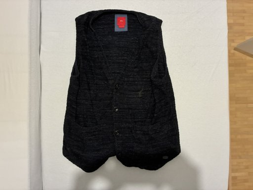</a>

**Kategorie:** jacke · **Farben:** schwarz

[Original ansehen](schrank/IMG_5260.JPEG)

#### Graue Lederjacke

**Kategorie:** jacke · **Farben:** grau

[Original ansehen](schrank/IMG_5262.JPEG)

#### Schwarze Lederjacke

**Kategorie:** jacke · **Farben:** schwarz, weiß

[Original ansehen](schrank/IMG_5266.JPEG)

#### Beige Strickweste mit Kapuze

<a href="https://github.com/Julian-Lukas/lookbook/blob/main/schrank/IMG_5270.JPEG">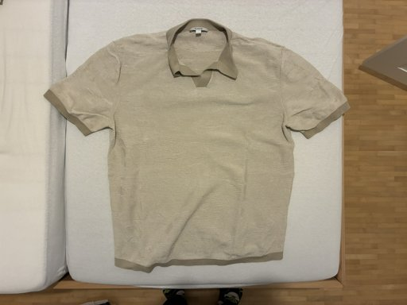</a>

**Kategorie:** jacke · **Farben:** beige

[Original ansehen](schrank/IMG_5270.JPEG)

#### Graue Strickweste

**Kategorie:** jacke · **Farben:** grau

[Original ansehen](schrank/IMG_5276.JPEG)

#### Schwarze gestreifte Weste

<a href="https://github.com/Julian-Lukas/lookbook/blob/main/schrank/IMG_5280.JPEG">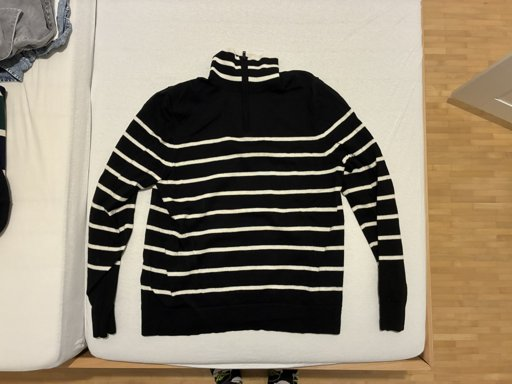</a>

**Kategorie:** jacke · **Farben:** schwarz, weiß

[Original ansehen](schrank/IMG_5280.JPEG)

#### Beige Herrenjacke

**Kategorie:** jacke · **Farben:** beige

[Original ansehen](schrank/IMG_5281.JPEG)

#### Beige Strickweste

**Kategorie:** jacke · **Farben:** beige

[Original ansehen](schrank/IMG_5288.JPEG)

#### schwarze Lederjacke

<a href="https://github.com/Julian-Lukas/lookbook/blob/main/schrank/IMG_5295.JPEG">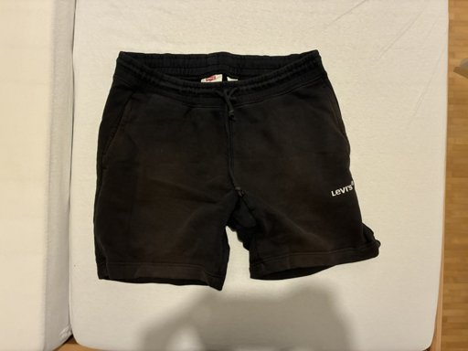</a>

**Kategorie:** jacke · **Farben:** schwarz

[Original ansehen](schrank/IMG_5295.JPEG)

#### Schwarze Lederjacke

<a href="https://github.com/Julian-Lukas/lookbook/blob/main/schrank/IMG_5300.JPEG">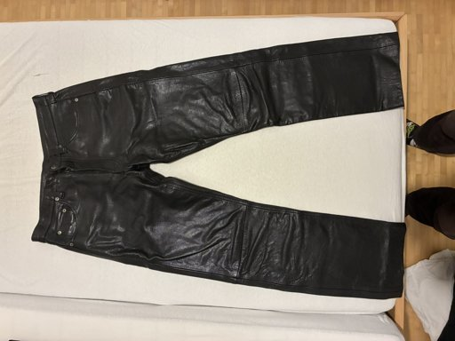</a>

**Kategorie:** jacke · **Farben:** schwarz

[Original ansehen](schrank/IMG_5300.JPEG)

#### Schwarze Lederjacke

<a href="https://github.com/Julian-Lukas/lookbook/blob/main/schrank/IMG_5304.JPEG">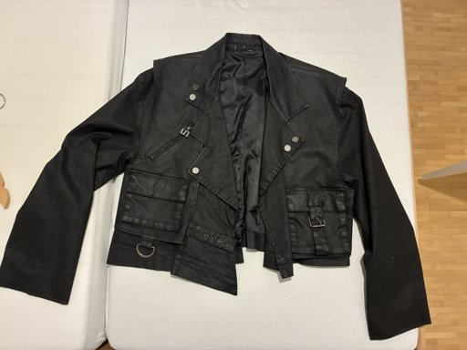</a>

**Kategorie:** jacke · **Farben:** schwarz

[Original ansehen](schrank/IMG_5304.JPEG)

### Schuh

#### Schwarze Damen-Sandalen

**Kategorie:** schuh · **Farben:** schwarz

[Original ansehen](schrank/IMG_5299.JPEG)

### Accessoire

#### Schwarze Umhängetasche

<a href="https://github.com/Julian-Lukas/lookbook/blob/main/schrank/IMG_5261.JPEG">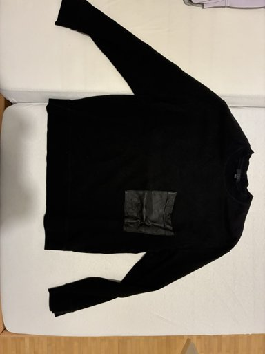</a>

**Kategorie:** accessoire · **Farben:** schwarz

[Original ansehen](schrank/IMG_5261.JPEG)

#### Schal mit Karomuster

**Kategorie:** accessoire · **Farben:** grün, schwarz, weiß

[Original ansehen](schrank/IMG_5277.JPEG)

#### Schwarze gestreifte Krawatte

<a href="https://github.com/Julian-Lukas/lookbook/blob/main/schrank/IMG_5289.JPEG">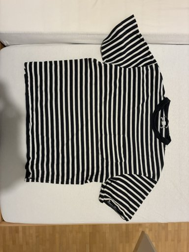</a>

**Kategorie:** accessoire · **Farben:** schwarz, weiß

[Original ansehen](schrank/IMG_5289.JPEG)

#### Schwarze Ledergürtel mit Schnalle

**Kategorie:** accessoire · **Farben:** schwarz

[Original ansehen](schrank/IMG_5294.JPEG)

#### Schwarze Stofftasche

**Kategorie:** accessoire · **Farben:** schwarz

[Original ansehen](schrank/IMG_5296.JPEG)

#### Braune Ledertasche

<a href="https://github.com/Julian-Lukas/lookbook/blob/main/schrank/IMG_5297.JPEG">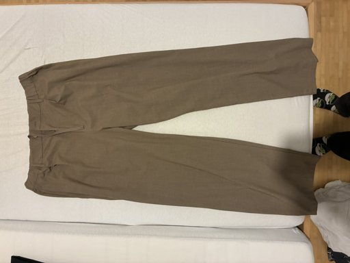</a>

**Kategorie:** accessoire · **Farben:** braun, beige

[Original ansehen](schrank/IMG_5297.JPEG)

#### Schwarze Umhängetasche

**Kategorie:** accessoire · **Farben:** schwarz

[Original ansehen](schrank/IMG_5301.JPEG)

### Sonstiges

#### weißes Bettlaken

**Kategorie:** sonstiges · **Farben:** weiß

[Original ansehen](schrank/IMG_5303.JPEG)

---

## Look-Ideen

Noch keine Looks in `look/` hochgeladen.

