# Mein digitales Lookbook

Automatisch generiert vom `lookbook_sync` Workflow. Originale liegen in [schrank/](schrank/) und [look/](look/).

---

## Mein Schrank

### Oberteil

#### Weißes Leinenhemd

<a href="https://github.com/Julian-Lukas/lookbook/blob/main/schrank/IMG_5263.JPEG">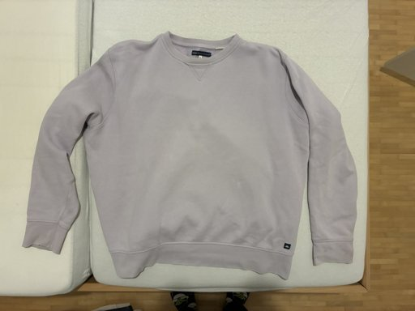</a>

**Kategorie:** oberteil · **Farben:** weiß · **Stil:** casual

_Ein lockeres, langärmeliges Leinenhemd mit Knopfleiste und leicht strukturierter Oberfläche, das einen lässigen Sommerlook unterstreicht._

[Original ansehen](schrank/IMG_5263.JPEG)

#### Grauer Strickpullover

**Kategorie:** oberteil · **Farben:** grau · **Stil:** casual

_Ein gemütlicher, langärmeliger Strickpullover mit einem kleinen Logo auf der Brust._

[Original ansehen](schrank/IMG_5264.JPEG)

#### Schwarzes T-Shirt

<a href="https://github.com/Julian-Lukas/lookbook/blob/main/schrank/IMG_5265.JPEG">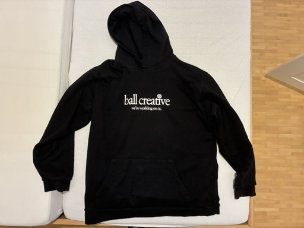</a>

**Kategorie:** oberteil · **Farben:** schwarz · **Stil:** casual

_Ein einfaches, schwarzes T-Shirt mit weißem Aufdruck des Logos 'ball creative' auf der Vorderseite._

[Original ansehen](schrank/IMG_5265.JPEG)

#### gestreifter Pullover

**Kategorie:** oberteil · **Farben:** blau, weiß · **Stil:** casual

_Ein langärmeliger, gestreifter Pullover mit einem klassischen, zeitlosen Design._

[Original ansehen](schrank/IMG_5267.JPEG)

#### Weißes Leinenhemd

<a href="https://github.com/Julian-Lukas/lookbook/blob/main/schrank/IMG_5268.JPEG">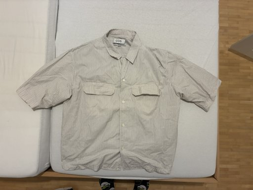</a>

**Kategorie:** oberteil · **Farben:** weiß · **Stil:** casual

_Ein locker geschnittenes, langärmliges Leinenhemd mit leicht strukturierter Oberfläche und Knopfleiste._

[Original ansehen](schrank/IMG_5268.JPEG)

#### Grauer Strickpullover

<a href="https://github.com/Julian-Lukas/lookbook/blob/main/schrank/IMG_5269.JPEG">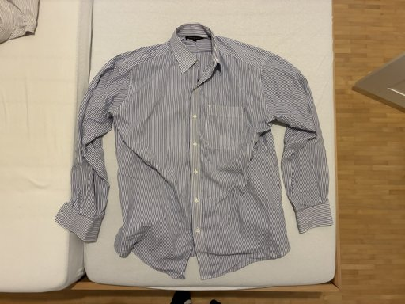</a>

**Kategorie:** oberteil · **Farben:** grau · **Stil:** casual

_Ein langärmeliger, hochgeschlossener Pullover aus weichem Strickmaterial mit glatter Oberfläche._

[Original ansehen](schrank/IMG_5269.JPEG)

#### Weißes Leinenhemd

<a href="https://github.com/Julian-Lukas/lookbook/blob/main/schrank/IMG_5271.JPEG">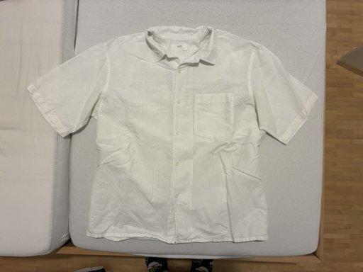</a>

**Kategorie:** oberteil · **Farben:** weiß · **Stil:** casual

_Ein lockeres, langärmliges Leinenhemd mit leichtem Faltenwurf und einem klassischen Kragen._

[Original ansehen](schrank/IMG_5271.JPEG)

#### grauer Denim Overall

**Kategorie:** oberteil · **Farben:** grau, dunkelblau · **Stil:** casual

_Ein lässiger, oversized Denim-Overall mit abgenutzten Details und seitlichen Schnallen an den Trägern._

[Original ansehen](schrank/IMG_5272.JPEG)

#### gestreifter Rollkragenpullover

<a href="https://github.com/Julian-Lukas/lookbook/blob/main/schrank/IMG_5273.JPEG">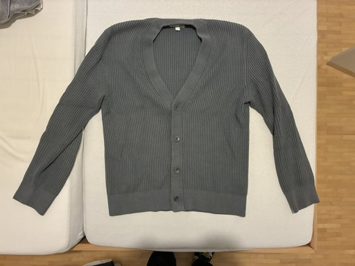</a>

**Kategorie:** oberteil · **Farben:** schwarz, weiß · **Stil:** casual

_Ein langärmeliger Rollkragenpullover mit feinen schwarzen und weißen Streifen, der einen klassischen, zeitlosen Look bietet._

[Original ansehen](schrank/IMG_5273.JPEG)

#### Grauer Strickpullover

<a href="https://github.com/Julian-Lukas/lookbook/blob/main/schrank/IMG_5274.JPEG">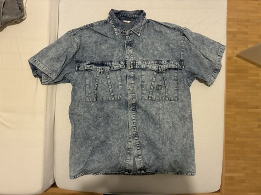</a>

**Kategorie:** oberteil · **Farben:** grau · **Stil:** casual

_Ein langärmliger, hochgeschlossener Pullover aus dickem, gemustertem Strickstoff._

[Original ansehen](schrank/IMG_5274.JPEG)

#### kariertes Hemd

**Kategorie:** oberteil · **Farben:** schwarz, weiß · **Stil:** casual

_Ein klassisches, kariertes Hemd mit schwarzem und weißem Muster, das auf einem Bügel präsentiert wird._

[Original ansehen](schrank/IMG_5275.JPEG)

#### Schwarzes T-Shirt mit Logo

**Kategorie:** oberteil · **Farben:** schwarz, weiß · **Stil:** streetwear

_Ein eng anliegendes, schwarzes T-Shirt mit einem auffälligen, weißen Puma-Logo auf der Brust._

[Original ansehen](schrank/IMG_5278.JPEG)

#### Schwarzes Rollkragen-Shirt

<a href="https://github.com/Julian-Lukas/lookbook/blob/main/schrank/IMG_5279.JPEG">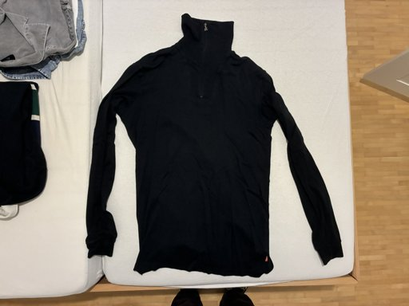</a>

**Kategorie:** oberteil · **Farben:** schwarz · **Stil:** casual

_Ein eng anliegendes, langärmliges Rollkragen-Shirt aus glattem, schwarzem Material._

[Original ansehen](schrank/IMG_5279.JPEG)

#### Beige Leinenbluse

<a href="https://github.com/Julian-Lukas/lookbook/blob/main/schrank/IMG_5282.JPEG">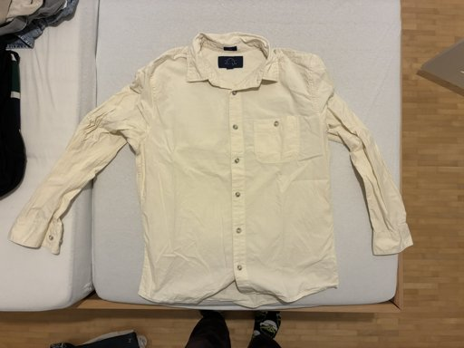</a>

**Kategorie:** oberteil · **Farben:** beige, weiß · **Stil:** casual

_Die lockere, langärmelige Bluse aus leichtem Leinenstoff mit Knopfleiste und zwei aufgesetzten Brusttaschen wirkt luftig und sommerlich._

[Original ansehen](schrank/IMG_5282.JPEG)

#### weißes Leinenhemd

**Kategorie:** oberteil · **Farben:** weiß · **Stil:** casual

_Ein lockeres, langärmliges Leinenhemd mit leichtem Faltenwurf und Knopfleiste._

[Original ansehen](schrank/IMG_5283.JPEG)

#### weißes Leinenhemd

**Kategorie:** oberteil · **Farben:** weiß · **Stil:** casual

_Ein lockeres, langärmliges Leinenhemd mit leicht strukturierter Oberfläche und einem kleinen Logo-Aufnäher auf der Brusttasche._

[Original ansehen](schrank/IMG_5284.JPEG)

#### lila Rollkragenpullover

<a href="https://github.com/Julian-Lukas/lookbook/blob/main/schrank/IMG_5285.JPEG">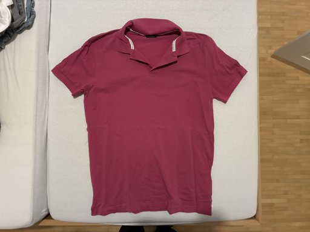</a>

**Kategorie:** oberteil · **Farben:** lila · **Stil:** casual

_Ein glatter, eng anliegender Rollkragenpullover in kräftigem Lila, der auf einem weißen Hintergrund drapiert ist._

[Original ansehen](schrank/IMG_5285.JPEG)

#### Schwarzes Rollkragen-Shirt

<a href="https://github.com/Julian-Lukas/lookbook/blob/main/schrank/IMG_5286.JPEG">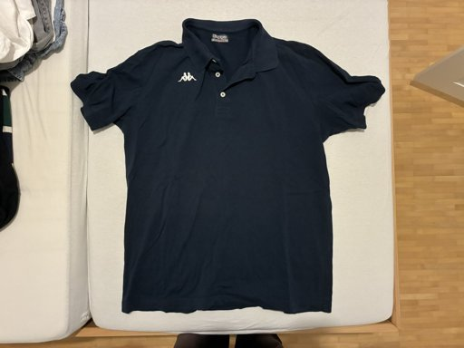</a>

**Kategorie:** oberteil · **Farben:** schwarz · **Stil:** casual

_Ein eng anliegendes, langärmeliges Rollkragen-Shirt aus einem glatten, matten Stoff._

[Original ansehen](schrank/IMG_5286.JPEG)

#### Schwarzes T-Shirt

<a href="https://github.com/Julian-Lukas/lookbook/blob/main/schrank/IMG_5287.JPEG">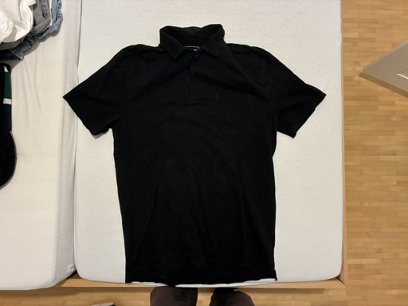</a>

**Kategorie:** oberteil · **Farben:** schwarz · **Stil:** casual

_Ein einfaches, langärmliges schwarzes T-Shirt mit rundem Ausschnitt und glattem Stoff._

[Original ansehen](schrank/IMG_5287.JPEG)

#### Grünes Leinen-Oberteil

<a href="https://github.com/Julian-Lukas/lookbook/blob/main/schrank/IMG_5290.JPEG">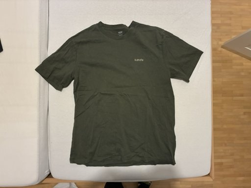</a>

**Kategorie:** oberteil · **Farben:** grün · **Stil:** casual

_Ein lockeres, langärmeliges Leinen-Oberteil in einem gedeckten Olivgrün mit einem kleinen Logo auf der Brust._

[Original ansehen](schrank/IMG_5290.JPEG)

#### schwarzes Rundhals-Shirt

<a href="https://github.com/Julian-Lukas/lookbook/blob/main/schrank/IMG_5291.JPEG">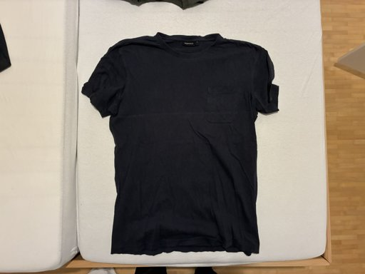</a>

**Kategorie:** oberteil · **Farben:** schwarz · **Stil:** casual

_Ein einfaches, glattes Rundhals-Shirt aus einem weichen, matten Stoff mit leichtem Fall._

[Original ansehen](schrank/IMG_5291.JPEG)

#### schwarzes Rundhals-Shirt

**Kategorie:** oberteil · **Farben:** schwarz · **Stil:** casual

_Ein einfaches, eng anliegendes Rundhals-Shirt aus schwarzem Stoff mit einem kleinen Logo auf der linken Brustseite._

[Original ansehen](schrank/IMG_5292.JPEG)

#### Schwarzes Rundhals-Shirt

<a href="https://github.com/Julian-Lukas/lookbook/blob/main/schrank/IMG_5293.JPEG">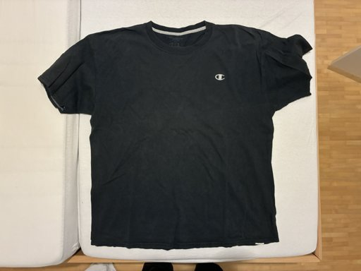</a>

**Kategorie:** oberteil · **Farben:** schwarz, weiß · **Stil:** casual

_Ein einfaches, langärmliges Rundhals-Shirt aus weichem, dunkelblauem bis schwarzem Stoff mit einem kleinen, dezenten Logo auf der linken Brustseite._

[Original ansehen](schrank/IMG_5293.JPEG)

### Hose

#### graue Stoffhose

**Kategorie:** hose · **Farben:** grau · **Stil:** casual

_Die Hose besteht aus einem glatten, leicht glänzenden Stoff und hat eine klassische, gerade Passform mit seitlichen Reißverschluss-Taschen._

[Original ansehen](schrank/IMG_5298.JPEG)

#### Beige Leinenhose

**Kategorie:** hose · **Farben:** beige · **Stil:** casual

_Eine lockere, bequeme Hose aus Leinen mit seitlichem Reißverschluss und zwei aufgesetzten Taschen._

[Original ansehen](schrank/IMG_5302.JPEG)

### Jacke

#### Schwarze Lederjacke

<a href="https://github.com/Julian-Lukas/lookbook/blob/main/schrank/IMG_5259.JPEG">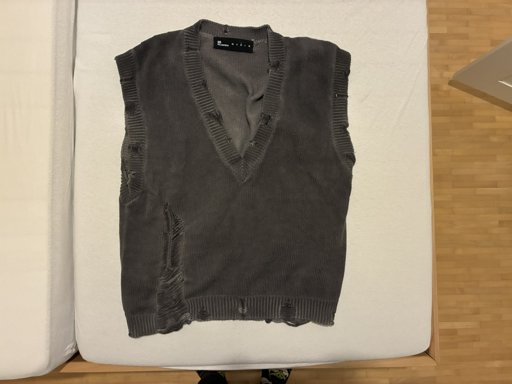</a>

**Kategorie:** jacke · **Farben:** schwarz · **Stil:** casual

_Eine klassische, eng anliegende Lederjacke mit Reißverschluss und zwei seitlichen Taschen._

[Original ansehen](schrank/IMG_5259.JPEG)

#### Schwarze Lederjacke

**Kategorie:** jacke · **Farben:** schwarz · **Stil:** casual

_Die glatte, schwarze Lederjacke mit Reißverschluss und kleinem Markenlogo auf der Brust ist ein zeitloses Statement für lässigen Style._

[Original ansehen](schrank/IMG_5260.JPEG)

#### Graue Lederjacke

<a href="https://github.com/Julian-Lukas/lookbook/blob/main/schrank/IMG_5262.JPEG">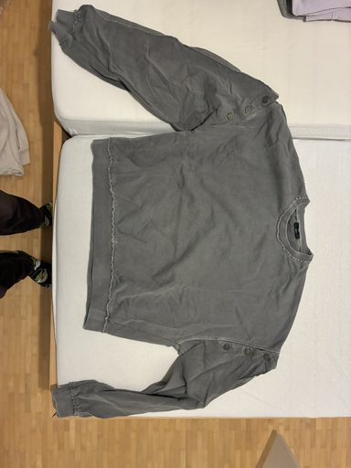</a>

**Kategorie:** jacke · **Farben:** grau · **Stil:** casual

_Die Jacke ist aus glattem Leder gefertigt und hat einen klassischen, lässigen Schnitt mit Reißverschluss und zwei seitlichen Taschen._

[Original ansehen](schrank/IMG_5262.JPEG)

#### Schwarze Lederjacke

<a href="https://github.com/Julian-Lukas/lookbook/blob/main/schrank/IMG_5266.JPEG">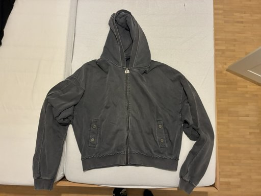</a>

**Kategorie:** jacke · **Farben:** schwarz, weiß · **Stil:** casual

_Eine klassische schwarze Lederjacke mit weißem Futter und Reißverschluss._

[Original ansehen](schrank/IMG_5266.JPEG)

#### Beige Strickweste mit Kapuze

**Kategorie:** jacke · **Farben:** beige · **Stil:** casual

_Die Weste ist aus weichem Strickmaterial gefertigt und mit einer praktischen Kapuze ausgestattet._

[Original ansehen](schrank/IMG_5270.JPEG)

#### Graue Strickweste

<a href="https://github.com/Julian-Lukas/lookbook/blob/main/schrank/IMG_5276.JPEG">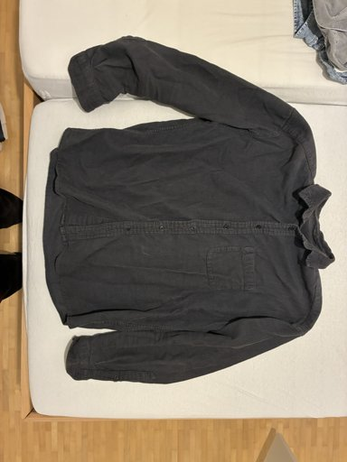</a>

**Kategorie:** jacke · **Farben:** grau · **Stil:** casual

_Eine gemütliche, taillierte Strickweste mit einem V-Ausschnitt und seitlichen Schlitzen für eine moderne Silhouette._

[Original ansehen](schrank/IMG_5276.JPEG)

#### Schwarze gestreifte Weste

**Kategorie:** jacke · **Farben:** schwarz, weiß · **Stil:** casual

_Eine kurze Weste mit horizontalen schwarzen und weißen Streifen, die auf einem Holzstuhl über einem weißen Hemd liegt._

[Original ansehen](schrank/IMG_5280.JPEG)

#### Beige Herrenjacke

<a href="https://github.com/Julian-Lukas/lookbook/blob/main/schrank/IMG_5281.JPEG">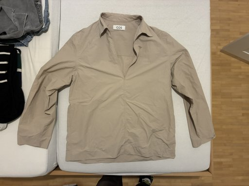</a>

**Kategorie:** jacke · **Farben:** beige · **Stil:** casual

_Die Jacke ist ein langes, beiges Modell mit zwei seitlichen Taschen und einem abnehmbaren Pelzfutter im Kragenbereich._

[Original ansehen](schrank/IMG_5281.JPEG)

#### Beige Strickweste

<a href="https://github.com/Julian-Lukas/lookbook/blob/main/schrank/IMG_5288.JPEG">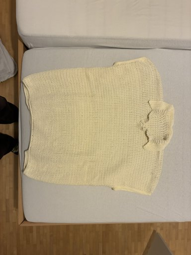</a>

**Kategorie:** jacke · **Farben:** beige · **Stil:** casual

_Eine einfache, beigefarbene Strickweste mit einem kleinen Logo-Anhänger an der rechten Seite._

[Original ansehen](schrank/IMG_5288.JPEG)

#### schwarze Lederjacke

**Kategorie:** jacke · **Farben:** schwarz · **Stil:** casual

_Eine klassische, eng anliegende schwarze Lederjacke mit Reißverschluss und markantem Logo auf der linken Brustseite._

[Original ansehen](schrank/IMG_5295.JPEG)

#### Schwarze Lederjacke

**Kategorie:** jacke · **Farben:** schwarz · **Stil:** casual

_Eine klassische schwarze Lederjacke mit glänzender Oberfläche und leicht strukturiertem Material._

[Original ansehen](schrank/IMG_5300.JPEG)

#### Schwarze Lederjacke

**Kategorie:** jacke · **Farben:** schwarz · **Stil:** casual

_Eine klassische schwarze Lederjacke mit Reißverschluss und seitlichen Reißverschluss-Taschen._

[Original ansehen](schrank/IMG_5304.JPEG)

### Schuh

#### Schwarze Damen-Sandalen

<a href="https://github.com/Julian-Lukas/lookbook/blob/main/schrank/IMG_5299.JPEG">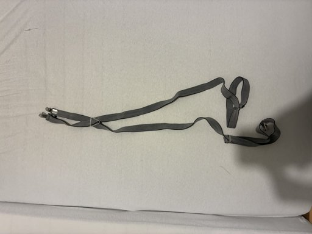</a>

**Kategorie:** schuh · **Farben:** schwarz · **Stil:** casual

_Elegante, flache Sandalen mit schmalen Riemchen und einem kleinen Absatz für einen lässigen, aber stilvollen Look._

[Original ansehen](schrank/IMG_5299.JPEG)

### Accessoire

#### Schwarze Umhängetasche

**Kategorie:** accessoire · **Farben:** schwarz · **Stil:** elegant

_Eine schlichte, schwarze Umhängetasche aus Leder mit einem minimalistischen Design und einem langen, verstellbaren Schulterriemen._

[Original ansehen](schrank/IMG_5261.JPEG)

#### Schal mit Karomuster

<a href="https://github.com/Julian-Lukas/lookbook/blob/main/schrank/IMG_5277.JPEG">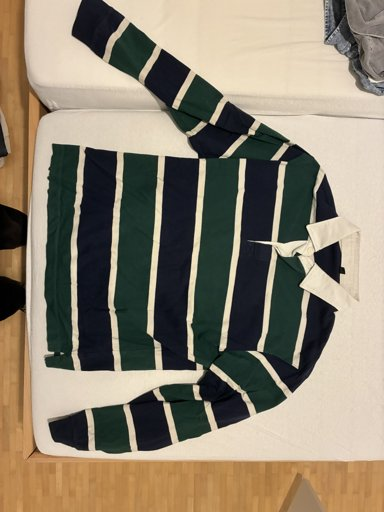</a>

**Kategorie:** accessoire · **Farben:** grün, schwarz, weiß · **Stil:** casual

_Ein langer, rechteckiger Schal mit einem markanten Karomuster in den Farben Grün, Schwarz und Weiß._

[Original ansehen](schrank/IMG_5277.JPEG)

#### Schwarze gestreifte Krawatte

**Kategorie:** accessoire · **Farben:** schwarz, weiß · **Stil:** business

_Eine schmale, gestreifte Krawatte mit einem klassischen Design, die sich für formelle Anlässe eignet._

[Original ansehen](schrank/IMG_5289.JPEG)

#### Schwarze Ledergürtel mit Schnalle

<a href="https://github.com/Julian-Lukas/lookbook/blob/main/schrank/IMG_5294.JPEG">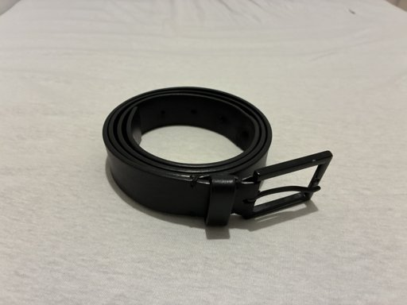</a>

**Kategorie:** accessoire · **Farben:** schwarz · **Stil:** elegant

_Ein klassischer, schmaler Ledergürtel mit einer rechteckigen Metallschnalle, der sich für formelle Anlässe eignet._

[Original ansehen](schrank/IMG_5294.JPEG)

#### Schwarze Stofftasche

<a href="https://github.com/Julian-Lukas/lookbook/blob/main/schrank/IMG_5296.JPEG">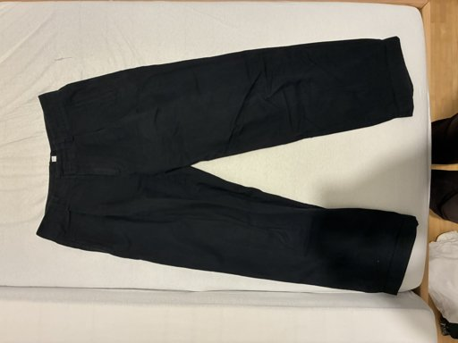</a>

**Kategorie:** accessoire · **Farben:** schwarz · **Stil:** casual

_Eine schlichte, schwarze Stofftasche mit strukturierter Oberfläche und einem geraden Henkel._

[Original ansehen](schrank/IMG_5296.JPEG)

#### Braune Ledertasche

**Kategorie:** accessoire · **Farben:** braun, beige · **Stil:** elegant

_Die schlichte, aber hochwertig wirkende Ledertasche mit strukturierter Oberfläche und abnehmbarer Kette als Verschluss eignet sich für formelle Anlässe._

[Original ansehen](schrank/IMG_5297.JPEG)

#### Schwarze Umhängetasche

<a href="https://github.com/Julian-Lukas/lookbook/blob/main/schrank/IMG_5301.JPEG">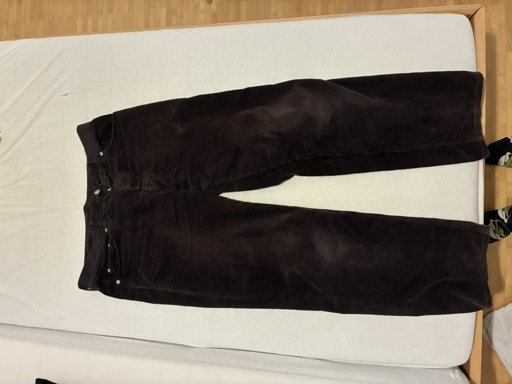</a>

**Kategorie:** accessoire · **Farben:** schwarz · **Stil:** casual

_Eine schlichte, schwarze Umhängetasche aus Leder mit einem weißen Logo auf der Vorderseite._

[Original ansehen](schrank/IMG_5301.JPEG)

### Sonstiges

#### weißes Bettlaken

<a href="https://github.com/Julian-Lukas/lookbook/blob/main/schrank/IMG_5303.JPEG">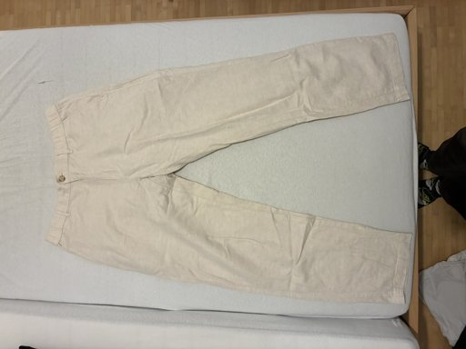</a>

**Kategorie:** sonstiges · **Farben:** weiß · **Stil:** neutral

_Ein glatt gebügeltes, weißes Bettlaken mit leicht sichtbaren Falten und einem kleinen Knopf an einer Ecke._

[Original ansehen](schrank/IMG_5303.JPEG)

---

## Look-Ideen

Noch keine Looks in `look/` hochgeladen.

